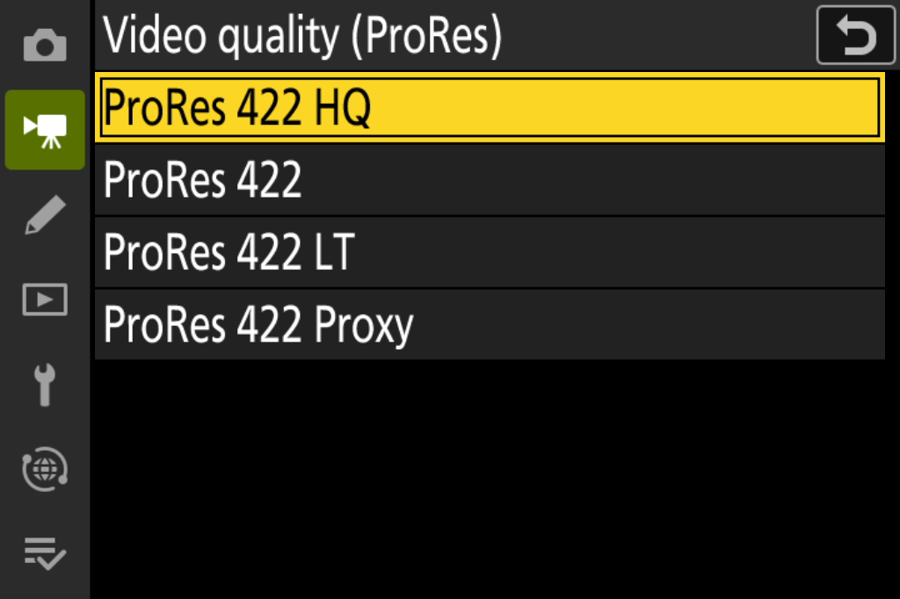
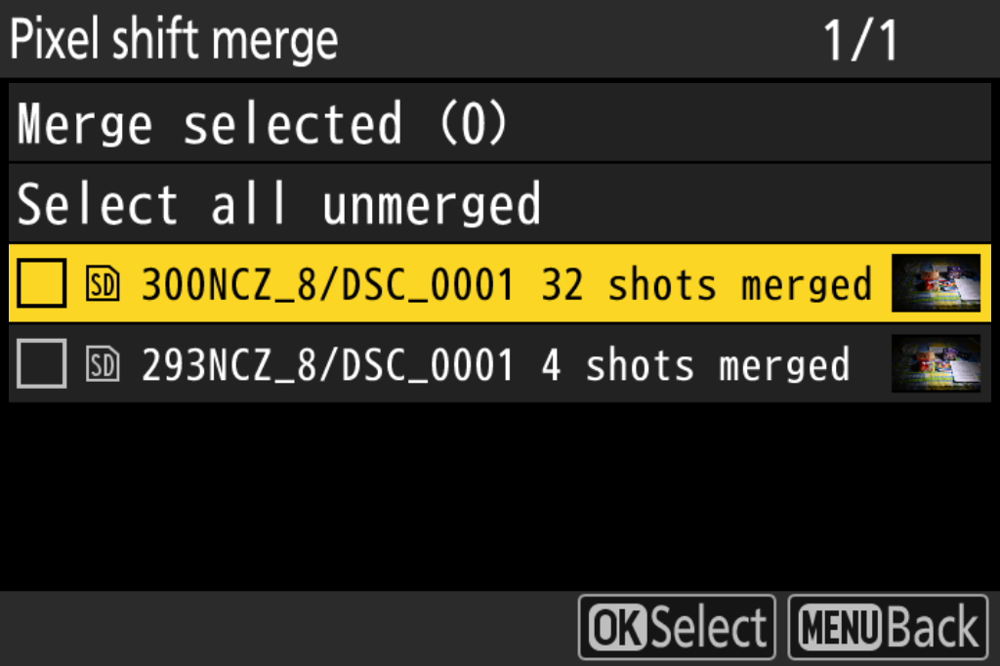
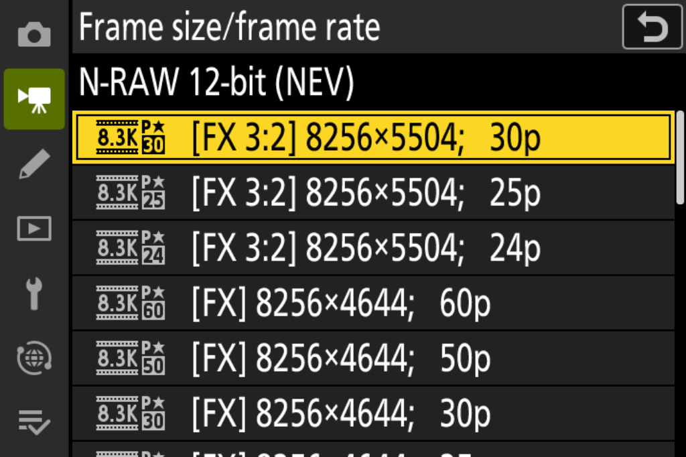
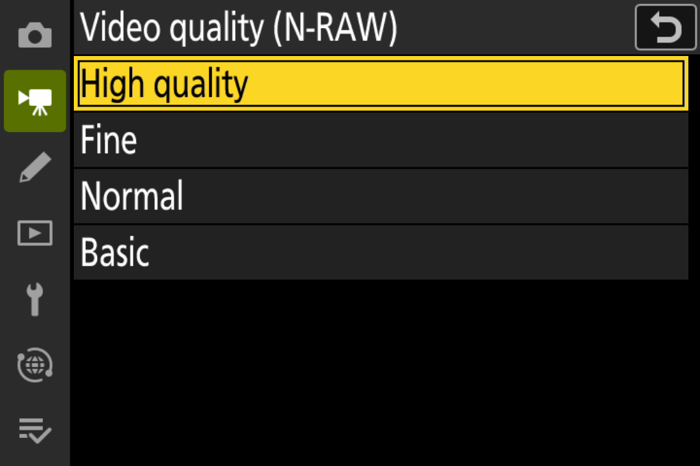

# NikonFirmwarePatch

## 04.18 实验分支。本仓库是 [XinmiaoZhao/NikonFirmwarePatch](https://github.com/XinmiaoZhao/NikonFirmwarePatch) v0.3.0-r1 的非官方分支，在四项功能之外加入 H.265 10-bit 的 Log3G10 / RWG 与 S-Log3 / S-Gamut3 两个色调行，以及卡内 WAV 快门声移植。新增部分未经原作者审阅或背书，见下方[04.18 实验](#0418-实验h265-log3g10--s-log3)。本仓库只提供方法与源码，不提供成品固件、解包模块或打包好的刷机文件。

[简体中文](#简体中文) · [English](#english) · [Changelog](CHANGELOG.md)

## 功能预览 / Feature preview

英文模拟器界面，用于展示功能菜单。Emulator UI in English, illustrating the feature menus.

| ProRes 画质 / ProRes quality | 像素位移合成 / Pixel-shift merge |
|---|---|
|  |  |
| **开放门帧率 / Open-gate frame rates** | **N-RAW 四档 / N-RAW quality tiers** |
|  |  |

## 简体中文

**当前工具修订：v0.3.0-r1。** 修复 Windows 构建时的源码路径校验错误（[issue #12](https://github.com/XinmiaoZhao/NikonFirmwarePatch/issues/12)），固件功能与 v0.3.0 相同。本工具从官方 **Nikon Z8 C 3.11** 生成用户选择功能的固件。上一工具包为 [v0.3.0](https://github.com/XinmiaoZhao/NikonFirmwarePatch/releases/tag/v0.3.0)，变化见[更新日志](CHANGELOG.md)。

| 选项 | 功能 |
|---|---|
| `prores` | ProRes HQ／Standard／LT／Proxy，按视频拍摄菜单库分别保存 |
| `precapture` | C15／C30 HE／HE★ RAW 连拍与预拍，普通画质菜单控制，计入 NEF 的剩余张数 |
| `pixelshift` | 机内浏览、选择像素位移组并合成 NEFX |
| `opengate-nraw` | FX 3:2 开放门 8.3K 30／25／24p，以及 N-RAW High／Fine／Normal／Basic 四档 |

任意非空选择共 15 种。ProRes 与“开放门＋N-RAW”可分别构建；开放门和 N-RAW 四档合为一个选项。

**这是实验固件，构建或安装可能造成数据丢失、卡损坏或相机故障。** 离线检查不等于实机安全保证，请勿用于不可替代的工作。无担保及责任条款见 [LICENSE](LICENSE) 和 [NOTICE](NOTICE.md)。

请自行从 [Nikon](https://downloadcenter.nikonimglib.com/en/download/fw/606.html) 取得官方输入并遵守其条款。工具包包含源码及四份自编译补丁，不分发完整 Nikon 固件、实拍原片或编译器；工具不会自动写卡或操作相机。旧版官方下载页失效时，可使用 [issue #11 中已核对的 Nikon 下载地址](https://github.com/XinmiaoZhao/NikonFirmwarePatch/issues/11#issuecomment-6493044598)。

### 构建与核验

从 [v0.3.0-r1 Release](https://github.com/XinmiaoZhao/NikonFirmwarePatch/releases/tag/v0.3.0-r1) 下载完整 [toolkit ZIP](https://github.com/XinmiaoZhao/NikonFirmwarePatch/releases/download/v0.3.0-r1/NikonFirmwarePatch-v0.3.0-r1-toolkit.zip)。Git 克隆及自动源码包只有源码，需要显式加 `--code-source source --compiler clang`；不要混用 v0.2.0 二进制。

需要 Python 3.10+ 和 `requirements.txt` 中的依赖。默认预编译模式不需要 Clang，不会下载补丁或静默转为编译；缺失或改动的机器码会阻止构建。已核对的源码编译器为 Apple clang 21.0.0（clang-2100.1.1.101）；其他编译器须产生相同的固定字节和入口地址。

安装依赖、构建并核验全功能固件：

```sh
python3 -m venv .venv
source .venv/bin/activate
python -m pip install -r requirements.txt
python patch.py "/path/to/Z_8_0311.bin" --features prores precapture pixelshift opengate-nraw --check
python patch.py "/path/to/Z_8_0311.bin" --features prores precapture pixelshift opengate-nraw --version 04.05 --tag p0 --output build/all
python verify.py "/path/to/Z_8_0311.bin" "build/all/Z_8_0405.bin" --features prores precapture pixelshift opengate-nraw --version 04.05 --tag p0
```

单独构建功能或使用交互选择：

```sh
python patch.py "/path/to/Z_8_0311.bin" --features prores --version 04.06 --tag p0 --output build/prores
python patch.py "/path/to/Z_8_0311.bin" --features opengate-nraw --version 04.07 --tag p0 --output build/opengate
python patch.py "/path/to/Z_8_0311.bin" --interactive --version 04.08 --tag p0 --output build/chosen
```

Windows 使用 `py -3 -m venv .venv` 创建环境，用 `.\.venv\Scripts\Activate.ps1` 激活，然后运行相同的 Python 命令。全部 15 种组合的构建回归在 macOS 上运行；Windows 路径回归与预编译 CLI 检查见[当前验证](docs/validation.md)。

未指定功能时默认只选 ProRes。版本格式为 `NN.NN`，tag 为小写字母加数字。Z8 支持降级和同版本重刷，不要求版本高于机身。工具不能读取机身版本或保证安装成功。

每次都从原厂输入构建，不把修改后的输出再次作为输入。已有输入或输出目录不会被覆盖。输出包含 `.bin`、`manifest.json` 和 `SHA256SUMS.txt`；独立调用 `verify.py` 时应提供预期功能、版本与 tag。

### 04.18 实验：H.265 Log3G10 / S-Log3

视频录制菜单 → 视频文件类型 → H.265 10-bit → 色调模式，N-Log 下方新增两行：

| 菜单行 | 取景标签 | Picture Control | 曲线 / 色域 |
|---|---|---|---|
| Log3G10 / RWG test | L3G10 | LOG3G10 | RED Log3G10 + REDWideGamutRGB |
| S-Log3 / S-Gamut3 | SLOG3 | S-LOG3 | Sony S-Log3 + S-Gamut3（全范围） |

两行都向原厂提交 N-Log 枚举，用独立开关选择私有 Lut1、NlgGamma、色域矩阵与名称；原厂 SDR、HLG、N-Log 数据不变。文件 VUI／colr 标为 2/2/1（未指定），后期需按取景标签或 Picture Control 名手动解释。

**状态：实验候选，未完成实机验证。** 已完成离线字节核验和 ARM 例程仿真；录制像素、关机后保留选择（尤其开关值 2）、两行直接切换、高光与卡内 WAV 发声仍需实机确认。

构建需要自行取得的官方 `Z_8_0311.bin`、`requirements-log3g10-research.txt` 中的依赖，以及五个预编译补丁单元。它们不在 Git 中，请从 [v04.18 Release](https://github.com/PIPA12344/NikonFirmwarePatch-04.18/releases/tag/v04.18) 下载 `opengate.bin`、`pixelshift.bin`、`pixelshift-af.bin`、`precapture.bin`（原项目 v0.3.0-r1 的四项功能，与其 toolkit ZIP 中的文件相同）和 `cardwav.bin`（卡内 WAV），放进 `resources/`。默认使用这些预编译单元，**不需要任何编译器**；文件哈希由 `resources/compiled.json` 与 `resources/cardwav.json` 固定，不一致会直接报错。

`cardwav.bin` 中替换原厂指令的 10 个位置已清零，构建时从你自己的 3.11 读出原指令填回，所以它不含 Nikon 固件内容。想自己编译时：四项功能加 `--code-source source --compiler clang`（需 Apple clang 21.0.0），卡内 WAV 加 `--card-wav-source source`（需 LLVM／clang 19.1.5，目录由 `Z8_LLVM_BIN` 指定）；编译结果同样必须与固定哈希一致。

```sh
python -m pip install -r requirements-log3g10-research.txt
python experimental_log3g10.py "/path/to/Z_8_0311.bin" --gamut rwg-slog3-dual --version 04.18 --no-tag --card-wav --output build/my-0418
python experimental_log3g10_verify.py "/path/to/Z_8_0311.bin" build/my-0418/Z_8_0418.bin --gamut rwg-slog3-dual --version 04.18 --no-tag --card-wav
python -m unittest tests.test_log3g10 -v
```

**复现维护者的 04.18。** 使用官方 `Z_8_0311.bin`、Release 中的五个预编译单元和上面的同一条命令，就会得到与维护者逐字节相同的固件：

```text
f790e606d828cabdc4d491ebe755427e25272e12e93dc405b29d076d7538a44e  Z_8_0418.bin
```

结构、地址、曲线来源与验证范围见 [H.265 Log3G10 / S-Log3 实验说明](docs/experimental-h265-log3g10.md)。

### 使用与文档

- 功能指南：[ProRes](docs/prores.md#简体中文)、[RAW／预拍摄](docs/raw-precapture.md#简体中文)、[像素位移](docs/pixelshift.md#简体中文)、[开放门／N-RAW](docs/opengate-nraw.md#简体中文)。
- [已知问题与功能限制](docs/known-issues.md)、[当前验证](docs/validation.md)、[上一公开版记录](docs/validation-v0.2.0.md)。
- [发布包与独立验证](docs/releases.md)、[更新日志](CHANGELOG.md)。

发现 `Z8PRESTP.BIN` 或 RAW 意外退成 JPEG 时，停止拍摄、等待写入结束并保留两卡文件，按[停止文件指南](docs/stop-file.md)处理。空的同名文件也会生效。

开发者回归命令：`python tests/validate_combinations.py --stock /path/to/Z_8_0311.bin --report build/combinations.json`，需要已核对的源码编译器。源码采用 GPL-3.0-only；不改变 Nikon 固件的许可。本项目与 Nikon 无隶属关系。

## English

**Current toolkit revision: v0.3.0-r1.** Fixes the Windows source-path verification failure ([issue #12](https://github.com/XinmiaoZhao/NikonFirmwarePatch/issues/12)); firmware features are unchanged from v0.3.0. This toolkit builds selected features from official **Nikon Z8 C 3.11**. The previous toolkit is [v0.3.0](https://github.com/XinmiaoZhao/NikonFirmwarePatch/releases/tag/v0.3.0); see the [changelog](CHANGELOG.md).

**04.18 experimental fork.** This repository is an unofficial fork of [XinmiaoZhao/NikonFirmwarePatch](https://github.com/XinmiaoZhao/NikonFirmwarePatch) v0.3.0-r1. On top of the four features it adds two H.265 10-bit tone rows, **Log3G10 / RWG** and **S-Log3 / S-Gamut3**, plus a port of the card WAV shutter sound. The additions are not reviewed or endorsed by the original authors; see [04.18 experiment](#0418-experiment-h265-log3g10--s-log3). Only the method and source are published: no finished firmware, extracted modules or packaged flashing files.

| Option | Feature |
|---|---|
| `prores` | ProRes HQ/Standard/LT/Proxy, stored per movie shooting bank |
| `precapture` | C15/C30 HE/HE★ RAW and pre-capture, ordinary-menu controls and NEF-aware remaining counts |
| `pixelshift` | In-camera pixel-shift group browsing, selection and NEFX merging |
| `opengate-nraw` | FX 3:2 open gate at 8.3K 30/25/24p and N-RAW High/Fine/Normal/Basic |

Choose any nonempty subset: 15 combinations. ProRes and open gate/N-RAW can be built separately; open gate and the four N-RAW tiers are one option.

**Experimental firmware: building or installing can cause data loss, card corruption or camera malfunction.** Offline checks do not guarantee camera safety. Do not use it for irreplaceable work. See the warranty and liability terms in [LICENSE](LICENSE) and [NOTICE](NOTICE.md).

Obtain the official input yourself from [Nikon](https://downloadcenter.nikonimglib.com/en/download/fw/606.html), subject to its terms. The toolkit contains source and four compiled patch units, not complete Nikon firmware, photographs or a compiler. It never writes a card or operates a camera. If the old download page is unavailable, see the [verified Nikon URLs in issue #11](https://github.com/XinmiaoZhao/NikonFirmwarePatch/issues/11#issuecomment-6493044598).

### Build and verify

Download the complete [toolkit ZIP](https://github.com/XinmiaoZhao/NikonFirmwarePatch/releases/download/v0.3.0-r1/NikonFirmwarePatch-v0.3.0-r1-toolkit.zip) from the [v0.3.0-r1 Release](https://github.com/XinmiaoZhao/NikonFirmwarePatch/releases/tag/v0.3.0-r1). Git clones and automatic source archives contain source only; add `--code-source source --compiler clang`. Do not mix v0.2.0 binaries with this source.

Python 3.10+ and the dependencies in `requirements.txt` are required. Default prebuilt mode needs no Clang and performs no downloads or compilation fallback. Missing or altered patch bytes stop the build. The reviewed source compiler is Apple clang 21.0.0 (clang-2100.1.1.101); another compiler must produce the same pinned bytes and entry addresses.

Install dependencies, then build and verify the all-features firmware:

```sh
python3 -m venv .venv
source .venv/bin/activate
python -m pip install -r requirements.txt
python patch.py "/path/to/Z_8_0311.bin" --features prores precapture pixelshift opengate-nraw --check
python patch.py "/path/to/Z_8_0311.bin" --features prores precapture pixelshift opengate-nraw --version 04.05 --tag p0 --output build/all
python verify.py "/path/to/Z_8_0311.bin" "build/all/Z_8_0405.bin" --features prores precapture pixelshift opengate-nraw --version 04.05 --tag p0
```

Build individual features or use interactive selection:

```sh
python patch.py "/path/to/Z_8_0311.bin" --features prores --version 04.06 --tag p0 --output build/prores
python patch.py "/path/to/Z_8_0311.bin" --features opengate-nraw --version 04.07 --tag p0 --output build/opengate
python patch.py "/path/to/Z_8_0311.bin" --interactive --version 04.08 --tag p0 --output build/chosen
```

On Windows, create the environment with `py -3 -m venv .venv` and activate `.\.venv\Scripts\Activate.ps1`, then run the same Python commands. All 15 build selections are checked on macOS; see [current validation](docs/validation.md) for Windows path regression and prebuilt CLI checks.

The default is ProRes only when no feature selection is supplied. Versions use `NN.NN`; tags use a lowercase letter and digit. Z8 supports downgrade and same-version reinstall, so the version need not exceed the installed one. The toolkit cannot read the camera version or guarantee installation.

Build from the official input each time; never use a patched output as input. Existing inputs/output directories are not overwritten. Outputs are the `.bin`, `manifest.json` and `SHA256SUMS.txt`. When invoking `verify.py` separately, specify the expected features, version and tag.

### 04.18 experiment: H.265 Log3G10 / S-Log3

Movie shooting menu → Video file type → H.265 10-bit → Tone mode gains two rows below N-Log:

| Row | Live-view tile | Picture Control | Curve / gamut |
|---|---|---|---|
| Log3G10 / RWG test | L3G10 | LOG3G10 | RED Log3G10 + REDWideGamutRGB |
| S-Log3 / S-Gamut3 | SLOG3 | S-LOG3 | Sony S-Log3 + S-Gamut3 (full range) |

Both rows submit the stock N-Log enum; a separate switch selects a private Lut1, NlgGamma, gamut matrix and name. Stock SDR, HLG and N-Log data are unchanged. VUI/colr are tagged 2/2/1 (unspecified), so interpret clips manually from the tile or Picture Control name.

**Status: experimental candidate, not fully camera-verified.** Offline byte checks and ARM routine emulation pass. Recorded pixels, power-off persistence (especially switch value 2), direct row-to-row switching, highlights and card WAV playback still need camera confirmation.

You need your own official `Z_8_0311.bin`, the dependencies in `requirements-log3g10-research.txt`, and five prebuilt patch units. They are not in Git: download `opengate.bin`, `pixelshift.bin`, `pixelshift-af.bin`, `precapture.bin` (the upstream v0.3.0-r1 units, identical to its toolkit ZIP) and `cardwav.bin` (card WAV) from the [v04.18 Release](https://github.com/PIPA12344/NikonFirmwarePatch-04.18/releases/tag/v04.18) into `resources/`. These are the default and **no compiler is needed**; their hashes are pinned by `resources/compiled.json` and `resources/cardwav.json`, and a mismatch stops the build.

The 10 slots in `cardwav.bin` that replay original instructions are zeroed and filled from your own 3.11 at build time, so it contains no Nikon firmware. To compile instead: add `--code-source source --compiler clang` for the four features (Apple clang 21.0.0) and `--card-wav-source source` for card WAV (LLVM/clang 19.1.5, folder set by `Z8_LLVM_BIN`); compiled output must still match the pinned hashes.

```sh
python -m pip install -r requirements-log3g10-research.txt
python experimental_log3g10.py "/path/to/Z_8_0311.bin" --gamut rwg-slog3-dual --version 04.18 --no-tag --card-wav --output build/my-0418
python experimental_log3g10_verify.py "/path/to/Z_8_0311.bin" build/my-0418/Z_8_0418.bin --gamut rwg-slog3-dual --version 04.18 --no-tag --card-wav
python -m unittest tests.test_log3g10 -v
```

**Reproducing the maintainer's 04.18.** The official `Z_8_0311.bin`, the five Release units and the same command above produce firmware byte-identical to the maintainer's:

```text
f790e606d828cabdc4d491ebe755427e25272e12e93dc405b29d076d7538a44e  Z_8_0418.bin
```

Structure, addresses, curve sources and validation scope (in Chinese): [H.265 Log3G10 / S-Log3 notes](docs/experimental-h265-log3g10.md).

### Use and documentation

- Feature guides: [ProRes](docs/prores.md#english), [RAW/pre-capture](docs/raw-precapture.md#english), [pixel shift](docs/pixelshift.md#english), [open gate/N-RAW](docs/opengate-nraw.md#english).
- [Known issues and limits](docs/known-issues.md#english), [current validation](docs/validation.md), [previous public release](docs/validation-v0.2.0.md).
- [Release contents and verification](docs/releases.md), [changelog](CHANGELOG.md).

If you find `Z8PRESTP.BIN` or unexpected JPEG-only output, stop shooting, let writes finish and preserve both cards' files. Follow the [stop-file guide](docs/stop-file.md#english-summary). An empty marker also takes effect.

Developer regression: `python tests/validate_combinations.py --stock /path/to/Z_8_0311.bin --report build/combinations.json`, using the reviewed source compiler. Source is GPL-3.0-only; Nikon firmware is not relicensed. This project is not affiliated with Nikon.

## 致谢 / Acknowledgements

感谢以下贡献者，**排名不分先后**。Acknowledgements are in no particular order.

- [@Mei-MingLe（日月）](https://github.com/Mei-MingLe)：提供研究思路和分析。
- [@heavensabove（pai）](https://github.com/heavensabove)：提供像素位移合成的基础代码和基础工作。
- [@y-g-jiang（Jiang Yaogeng）](https://github.com/y-g-jiang)：提供研究思路与建议，并通过技术讨论帮助完善方案。
- [@ShiSheng233（锂化溴）](https://github.com/ShiSheng233)：提供开放门的思路、框架及相关参考实现。
- [@aoyukkk（傲宇）](https://github.com/aoyukkk)、[@South-Bridge（琴岛唯一指定哥布林）](https://github.com/South-Bridge)和“追晚霞的流浪汉”：协助开发、开展实机测试并反馈问题。

English descriptions of these contributions are included in [NOTICE](NOTICE.md#contributor-acknowledgements).

感谢 [RdWing/z8-qemu](https://github.com/RdWing/z8-qemu)、[WonderLantern/z9-qemu](https://github.com/WonderLantern/z9-qemu)、[WonderLantern/z7-qemu](https://github.com/WonderLantern/z7-qemu)与 [QEMU](https://www.qemu.org/) 的基础工作；依赖与许可范围见 [NOTICE](NOTICE.md)。
